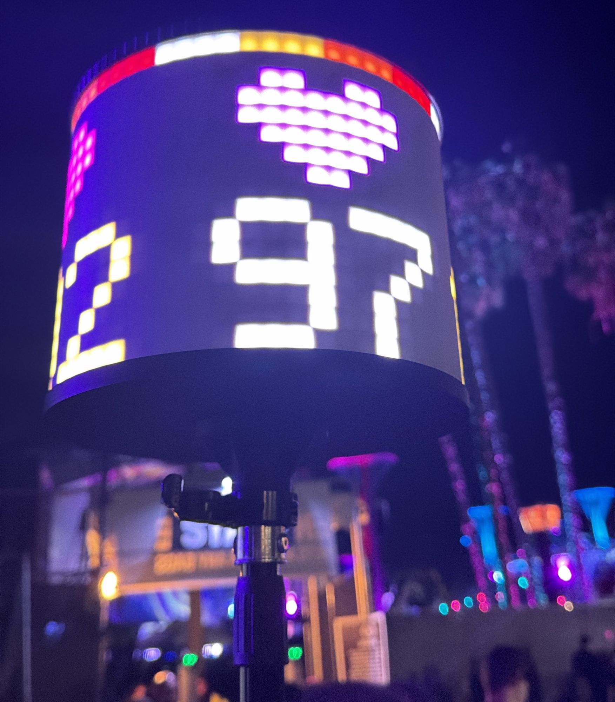

# Heart Rate Totem



A glowing ring on a pole that shows your live heart rate to the crowd.

Four flexible LED panels wrap round a 3D printed core. A small ESP32-S3 board inside reads your heart rate strap over Bluetooth and draws a beating heart, your BPM and a zone-coloured bar on every side. Every few minutes it plays a show for the people around you: the faces spin round the ring, or a phrase scrolls past. A friend's heart rate can share the ring with yours, the board's microphones catch the beat drop, and a web page on your phone works as a remote.

**No soldering. No cutting wires.** Everything plugs in or goes under a screw.

See it in action on Instagram: **[@heartratetotem](https://www.instagram.com/heartratetotem/)**.

<br clear="right">

## Build your own

Start with the **[build guide](docs/build-guide.md)**. It walks through everything in order, assuming no electronics or 3D printing experience:

| Step | Time |
|---|---|
| [Buy the parts](docs/build-guide.md#parts-and-tools) | order early |
| [Print the parts](docs/build-guide.md#print-the-parts) | 30 to 40 hours of printer time |
| [Wire it on the table](docs/build-guide.md#wiring) | 1 to 2 hours |
| [Flash the firmware](docs/build-guide.md#flash-the-firmware) | about 1 hour the first time |
| [Put it together](docs/build-guide.md#put-it-together) | 1 to 2 hours |
| [Test it](docs/build-guide.md#test-it) | a 1-hour burn-in |

You'll need a 3D printer (bed at least 230 x 230 mm), a computer to flash the board, and a Bluetooth heart rate source: a Whoop with HR Broadcast on, or any standard chest strap.

## What's in this repo

| Folder | What it is |
|---|---|
| [`docs/build-guide.md`](docs/build-guide.md) | The step-by-step build guide |
| [`hardware/releases/v1/`](hardware/releases/v1/) | Ready-to-print 3MF files, settings saved inside |
| [`hardware/`](hardware/README.md) | The Python scripts that generate every printed part, if you want to change a size |
| [`firmware/totem/`](firmware/totem/) | The Arduino sketch that runs the totem |
| [`firmware/totem_panel_test/`](firmware/totem_panel_test/) | A one-panel wiring test to flash before the real firmware |
| [`firmware/find_whoop_mac/`](firmware/find_whoop_mac/) | Finds your strap's Bluetooth address |
| [`docs/remote/`](docs/remote/index.html) | The phone remote page (served by GitHub Pages) |
| [`docs/firmware.md`](docs/firmware.md) | Developer notes: command-line builds, shows, phone protocol, beat drop, hardware gotchas |
| [`tests/`](tests/) | Host-side tests for the zone math, layouts, shows and protocol (`make -C tests`) |
| [`tools/`](tools/) | `build.sh` (compile and flash with arduino-cli) and `serial_monitor.py` |

## Versions

- **v1** (this is what's documented and tested): four 16x16 panels in a ring, printed in eight parts, first run at Dreamstate 2026.
- **v2** (in progress): see the [v2 roadmap](docs/v2.md). A six-panel round drum, and the song's BPM shown alongside the heart rates.

## Development

```bash
make -C tests          # host tests, no board needed (also run in CI)
tools/build.sh         # compile the totem firmware with arduino-cli
tools/build.sh totem /dev/cu.usbmodem1101   # compile and flash
python3 tools/serial_monitor.py /dev/cu.usbmodem1101
```

More in [docs/firmware.md](docs/firmware.md).

## History

The totem started life in [noahsw/biohacker_bro](https://github.com/noahsw/biohacker_bro), a chest-mounted heart rate display built for a Halloween costume. It grew into its own thing, so it moved here. The full commit history of the firmware up to v1 lives in that repo.

## License

The code (firmware, scripts, phone page) is [MIT](LICENSE). The print files, build guide and images are [CC BY-NC-SA 4.0](https://creativecommons.org/licenses/by-nc-sa/4.0/): build one, remix it and share your changes, but not for commercial use without asking. See [LICENSE](LICENSE) for which files are which.
