# Heart rate totem: build guide

**Print it, wire it, flash it, put it together.**

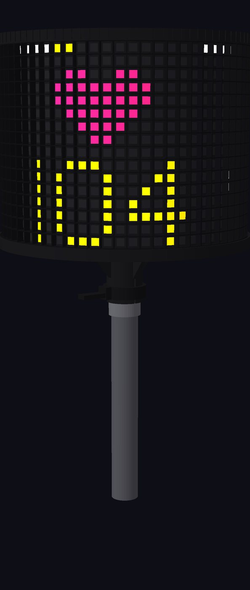

A glowing ring on a pole that shows your live heart rate to the crowd. Four flexible LED panels wrap round a 3D printed core. A small computer board inside reads your heart rate strap over Bluetooth and draws a beating heart, your BPM and a colour bar on every side.

Every so often it plays a show for the people around you: the faces spin round the ring, or a phrase scrolls past. A friend's heart rate can share the ring with yours.

No soldering. No cutting wires. Everything plugs in or goes under a screw.

| You'll spend about | |
|---|---|
| Printing | 30 to 40 hours of printer time |
| Wiring and testing | 1 to 2 hours |
| Flashing the firmware | about 1 hour the first time |
| Putting it together | 1 to 2 hours |

You don't need electronics or 3D printing experience. Go one step at a time, and do the tests where the guide asks: each one catches a problem while it's still easy to fix.

 

## Contents

1. [What it does](#what-it-does)
2. [Before you start](#before-you-start)
3. [Parts and tools](#parts-and-tools)
4. [Print the parts](#print-the-parts)
5. [Wiring](#wiring)
6. [Flash the firmware](#flash-the-firmware)
7. [Put it together](#put-it-together)
8. [Test it](#test-it)
9. [Troubleshooting](#troubleshooting)
10. [Festival-day checklist](#festival-day-checklist)
11. [Good to know](#good-to-know)

---

## What it does

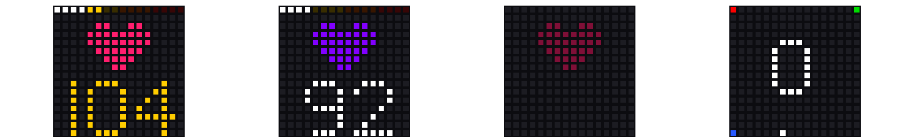

| You | A friend | Searching | Orientation test |
|---|---|---|---|
| Pink heart, your BPM. The colour shows your zone. | Purple heart on the two other sides, if a friend's strap is set up. | Heart beats slowly with no number until your strap connects. | A setup screen you'll use once, in [Flash the firmware](#flash-the-firmware). |

### The heart rate faces

All four sides show the same picture at the same time: a bar along the top, a heart that pulses on every beat, and your heart rate in beats per minute (BPM). When a friend's strap is connected, two opposite sides show them with a purple heart and the other two show you with a pink heart.

| Heart rate | Colour | Bar |
|---|---|---|
| Under 100 | White | First quarter |
| 100 to 109 | Yellow | Second quarter |
| 110 to 119 | Orange | Third quarter |
| 120 and up | Red | Last quarter |

The zones are set for a resting heart rate of about 60 and hard dancing at about 110. You can change them (see [Settings you might want to change](#settings-you-might-want-to-change)).

The bar fills from left to right as your heart rate climbs. The pixel where you are now blinks, so you can find it at a glance.

### Shows for the crowd

Every 5 minutes the heart rate steps aside for one show. The two kinds take turns, so each comes round about every 10 minutes:

- **Spin:** the faces race round the ring four times, like a stock ticker. About 15 seconds.
- **Phrases:** a line of text, such as WE'RE ALL WE NEED, scrolls round the ring three times. About 1 to 2 minutes. You can write your own phrases.
There's also a third show you can turn on: the **Queen Mary**, an ocean liner sailing round the ring under the stars, made for Dreamstate 2026, which was held right next to the RMS Queen Mary. It's a good starting point if you want a show of your own for your own event.

### Beat drop

The board's two microphones listen to the bass. When the music drops after a breakdown, two rings burst out from the heart on every face. It calibrates itself to the room, and it's tuned to miss a borderline drop rather than fire on something that isn't one.

### Phone remote

A web page on your iPhone talks to the totem over Bluetooth. Scroll your own text, play a show now, pause the shows, change the brightness, turn the lights off and on, and see who's connected. A PIN keeps strangers out.

### Brightness

Roll the thumb wheel on the board for brighter or dimmer, or press it in to step through five levels. A full battery lasts about 6.5 to 7 hours at the middle level.

---

## Before you start

### The big picture

1. **Buy the parts** (next section). Order early: the printing alone takes a few days.
2. **Print the plastic parts.** Start with the fit test. Let the printer run while you do the next steps.
3. **Wire it on the table.** Flat, outside the totem, so you can see everything.
4. **Flash the firmware** from a computer and test the panels while they're still on the table.
5. **Put it together** on the printed core, then fit it to the pole.
6. **Run a 1-hour test** and a shake test before the big day.

### Four rules that keep the electronics safe

- **Red only ever meets red, black only ever meets black.** Red is 5V (plus), black is GND (minus). Swapping them can damage the panels.
- **The board's cable goes in the port marked USB-C, not the one marked Power.** On Power alone the board stays dark.
- **Plug the battery in last**, after every other connection is made and checked. Unplug it before you change any wire.
- **A data wire in the wrong spot can't hurt anything.** If the panels stay dark, you can move it and try again.

### Words you'll meet

| Word | What it means |
|---|---|
| 3MF file | A 3D print file. The ones for this build already have the right settings saved inside. |
| Slicer | The app that turns a 3MF file into instructions for the printer. This guide uses Bambu Studio. |
| Filament | The plastic the printer melts, sold on spools. PLA is the easy everyday kind; PETG is a bit tougher and bends before it breaks. |
| Wall loops, infill | How thick the outside of a part is, and how solid the inside is. The files set these for you. |
| Supports, brim | Supports hold up overhangs while printing (none are needed here). A brim is a thin skirt that helps tall thin parts stick to the bed. |
| Spiral vase | A print mode that makes a thin tube in one continuous line. Used for the white skin. |
| 5V and GND | The two power wires. 5V (red) is plus, GND or ground (black) is minus. Power flows out on 5V and back on GND. |
| Data | The wire that tells the LEDs what colour to be. It carries signals, not power. |
| JST plug | The small 3-pin plastic plug on the panels' leads. It clicks together one way only. |
| Barrier strip | A terminal block: a row of screws on a plastic bar. Wires under screws in the same row are joined. |
| Fork terminal | A U-shaped metal end on a wire that slides under a screw. |
| HUB75 | The wide 16-pin connector on the board. We use just one of its pins for data. |
| Firmware, flashing | The program that runs on the board, and copying it onto the board from a computer. |
| MAC address | A Bluetooth device's ID, like `AA:BB:CC:DD:EE:FF`. The totem uses it to find your strap and nobody else's. |

---

## Parts and tools

### Parts to buy

These are the parts the original build used. Similar parts work, but the printed parts are sized for the panels, board, clamp and battery listed here.

| Part | What it's for | Link |
|---|---|---|
| LED panels, 16 x 16, WS2812B, flexible (BTF-LIGHTING) | The four sides of the ring. You need 4. | [amazon.com/dp/B09XWQTZZN](https://www.amazon.com/dp/B09XWQTZZN) |
| ESP32-S3 HUB75 controller board with audio | The computer inside the totem. | [amazon.com/dp/B0H6P7QCV2](https://www.amazon.com/dp/B0H6P7QCV2) |
| 3-pin JST connector pairs | One lead carries the data from the board to panel 1. | [amazon.com/dp/B0BW777LBK](https://www.amazon.com/dp/B0BW777LBK) |
| Terminal block (barrier strip), 2 positions | Joins the board's power wires to panel 1's. | [amazon.com/dp/B0F6VB9NTV](https://www.amazon.com/dp/B0F6VB9NTV) |
| Right-angle USB-C cable, short | Battery to board, inside the core. | [amazon.com/dp/B0FX2N4MJL](https://www.amazon.com/dp/B0FX2N4MJL) |
| Bike seatpost clamp (ROCKBROS, 31.8 mm) | Locks the totem onto the pole. | [amazon.com/dp/B0CXCVS79J](https://www.amazon.com/dp/B0CXCVS79J) |
| Hook-and-loop tape | The strap that holds the battery in. | [amazon.com/dp/B0GHM172GL](https://www.amazon.com/dp/B0GHM172GL) |
| Felt pads | Stop the battery rattling in its cradle. | [amazon.com/dp/B0H8CK8C2T](https://www.amazon.com/dp/B0H8CK8C2T) |
| Bluetooth heart rate monitor | A strap for a friend (or for you, if you don't have a Whoop). | [amazon.com/dp/B09BCFRKR6](https://www.amazon.com/dp/B09BCFRKR6) |

The board is sold by WatangTech; its model is Seengreat's "RGB Matrix HUB75 S3" ([maker's wiki](https://seengreat.com/wiki/214/rgb-matrix-hub75-s3)).

### You'll also need

| Item | Notes |
|---|---|
| Power bank: Anker 537 (PowerCore 24K) | 160 x 85 x 26 mm. The battery cradle is shaped for this one. |
| Telescoping pole with a screw-on tip | The kind with a mop or paint-roller thread (3/4 inch Acme). The adapter screws onto it. Many festivals limit poles: check the rules (one we went to allowed aluminium poles 1 inch or thinner, totems up to 10 ft). |
| Filament | Black PLA: about 0.85 kg (buy 2 spools to be safe). White PLA: about 100 g. Black PETG (matte): about 100 g, for the pole adapter. |
| M3 flat-head (countersunk) screws and nuts | 14 x M3x12, 4 x M3x16, 4 x M3x20, and 22 M3 hex nuts. An assortment kit covers it. |
| 4-pin power cable with fork ends | Plugs into the board's 4-pin power socket. One may come with the board or the panels. |
| HUB75 breakout cable | 16-pin ribbon plug on one end, separate small plugs on the other. One may come with the board. |
| Electrical tape | For taping off unused wires. |
| Heart rate source for you | A Whoop with HR Broadcast turned on, or any Bluetooth heart rate strap. |

### Tools

- 3D printer and Bambu Studio (this guide uses a Bambu Lab A2L; any printer with a bed at least 230 x 230 mm should fit the parts).
- Screwdriver or hex key for your M3 screws, and small pliers to hold nuts.
- Scissors, and flush cutters or a craft knife for cleaning up prints.
- A computer (Mac or Windows) and a USB-C data cable, for flashing the firmware.
- An iPhone with the free Bluefy browser, for the phone remote (optional).
- A multimeter (optional, for the extra checks in [Wiring](#wiring)).

---

## Print the parts

There are eight print files in [`hardware/releases/v1/`](../hardware/releases/v1/). Each one has its settings saved inside, so you mostly just open, slice and print. Print everything in black except the skin (white) and the pole adapter (black PETG).

| | Part | |
|---|---|---|
| 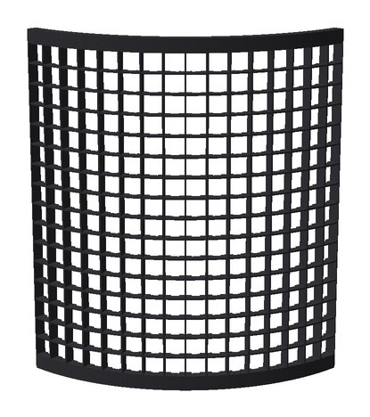 | **Grid quarter** `grid.3mf` | Black PLA. Print 4 (one per panel). 2 walls and a brim. |
| 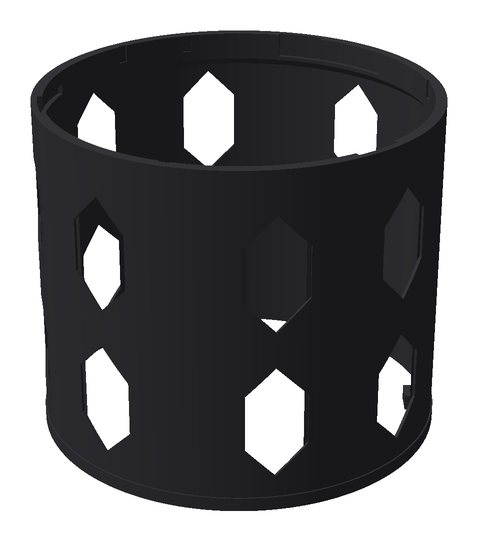 | **Core** `core.3mf` | Black PLA. The cylinder the panels wrap round. 4 walls. |
| 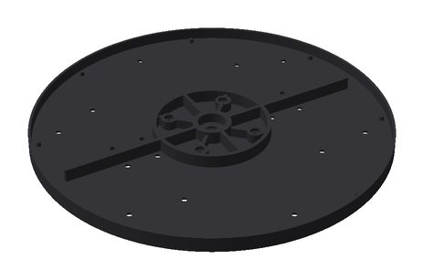 | **Base** `base.3mf` | Black PLA. Everything bolts to it. 3 walls, 25% infill. |
| 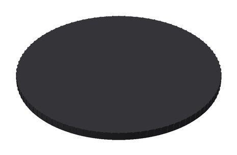 | **Cap** `cap.3mf` | Black PLA. Twists on and clicks. 3 walls, 25% infill. |
| 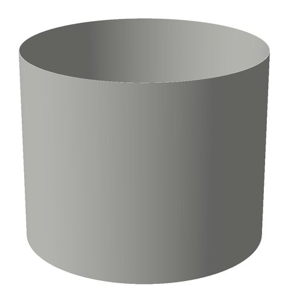 | **Skin** `skin.3mf` | White PLA. Thin tube that turns each LED into a soft square. Spiral vase. |
| 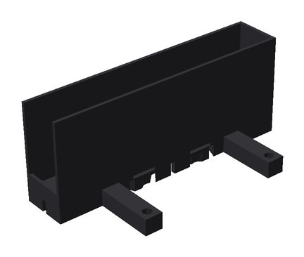 | **Battery cradle** `cradle537.3mf` | Black PLA. Holds the Anker 537 on its long edge. 3 walls. |
| 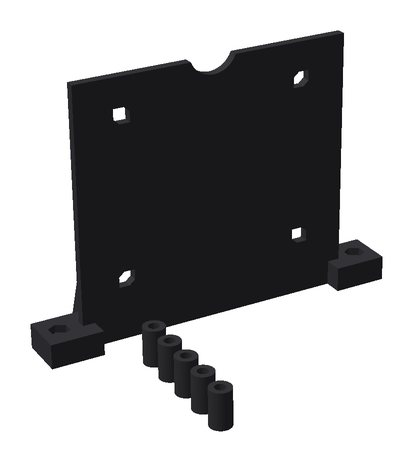 | **Board plate** `board.3mf` | Black PLA. The board stands on it. 5 spacers: 4 plus a spare. |
| 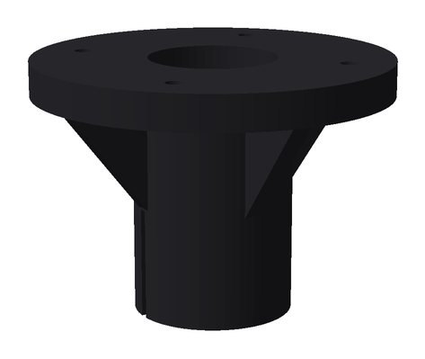 | **Pole adapter** `adapter_thread.3mf` | Black PETG. 6 walls, 100% infill. The strongest part. |

The settings above are already in the files. They're listed so you can check them, and so you know what to set if you ever re-export a file.

| Part | Rough time | Plastic |
|---|---|---|
| Grid quarter | 3 to 4 h each | about 44 g each |
| Core | 6 to 8 h | about 230 g |
| Base | 3.5 to 4.5 h | about 140 g |
| Cap | 2.5 to 3.5 h | about 115 g |
| Skin | 1.5 to 2 h | about 90 g |
| Cradle, board plate, adapter | 5 to 6 h together | about 150 g |

These are estimates. Bambu Studio shows the real numbers after you slice.

### Printing a file in Bambu Studio

1. Open Bambu Studio and pick your printer at the top left. Use the **0.20mm Standard** process for your printer.
2. File > Open, and choose the 3MF file. If it asks whether to load the settings saved in the file, say **yes**.
3. Load the right filament in the printer and pick the matching filament on the left (for example Bambu PLA Basic, black).
4. Leave **Supports** off. The parts are placed so they don't need any.
5. Click **Slice plate** (top right). Look at the preview: the part should sit flat on the plate, with no warning in red.
6. Click **Print plate**, then confirm on the printer. Keep the bed clean: wipe it with a little dish soap and water if prints stop sticking.

### Print order

1. **Fit test first.** Print one grid quarter. When it's done, press one panel into it, LEDs into the square cells. The fins should sit between the LED columns and the panel shouldn't rattle.
2. If the fit is good, print the other three grid quarters, then the core, base, cap, battery cradle and board plate.
3. Print the **pole adapter** in black PETG (change the filament in the printer and in Bambu Studio). Print it flange down, as placed, with 100% infill. It takes the sway of the totem, so don't skimp on it.
4. Print the **skin** last, in white, once you know the grid fits.

> **Careful:** If the grid quarter is too tight or too loose, stop there and adjust the design before printing the rest. The sizes are settings at the top of [`hardware/v1/build_modular.py`](../hardware/v1/build_modular.py); see [`hardware/README.md`](../hardware/README.md) for how to rebuild.

### The skin (spiral vase)

The skin is a single line of white plastic, 0.6 mm thick, printed in spiral vase mode. Before you print it:

- In the preview, use the slider on the right to look at a few layers. It should be **one single line** all the way up.
- If it shows two lines, open the Others tab and turn **Spiral vase** on, and set Quality > Line width > Outer wall to 0.6 mm.
- If it prints too fragile, there's a thicker backup (0.84 mm, two walls): run `python3 build.py v1` in [`hardware/`](../hardware/README.md) and print `A2L - Skin 0.84 mm fallback (white).3mf`. Turn its seam line over a fin when you fit it.

### Clean-up after printing

- Peel off the brims and any stringy bits. Flush cutters work well.
- Push an M3 nut into a hex pocket to check it fits. If it's tight, warm the pocket with a hair dryer, or press the nut in with a screw from the other side.
- Test the cap: put it on the core's top, turn it clockwise (looking from above) about a quarter of a hand-span. It should click.

---

## Wiring

There are only three kinds of connection, and nothing gets soldered:

- **Power for the board:** one USB-C cable from the battery.
- **Power for the LEDs:** the board has a 4-pin power output. Its cable goes to a barrier strip, and the strip feeds panel 1. The panels pass power on to each other through their 3-pin plugs.
- **Data for the LEDs:** one thin wire from the board to panel 1. Panel 1 passes the data on to panel 2, and so on round the ring.

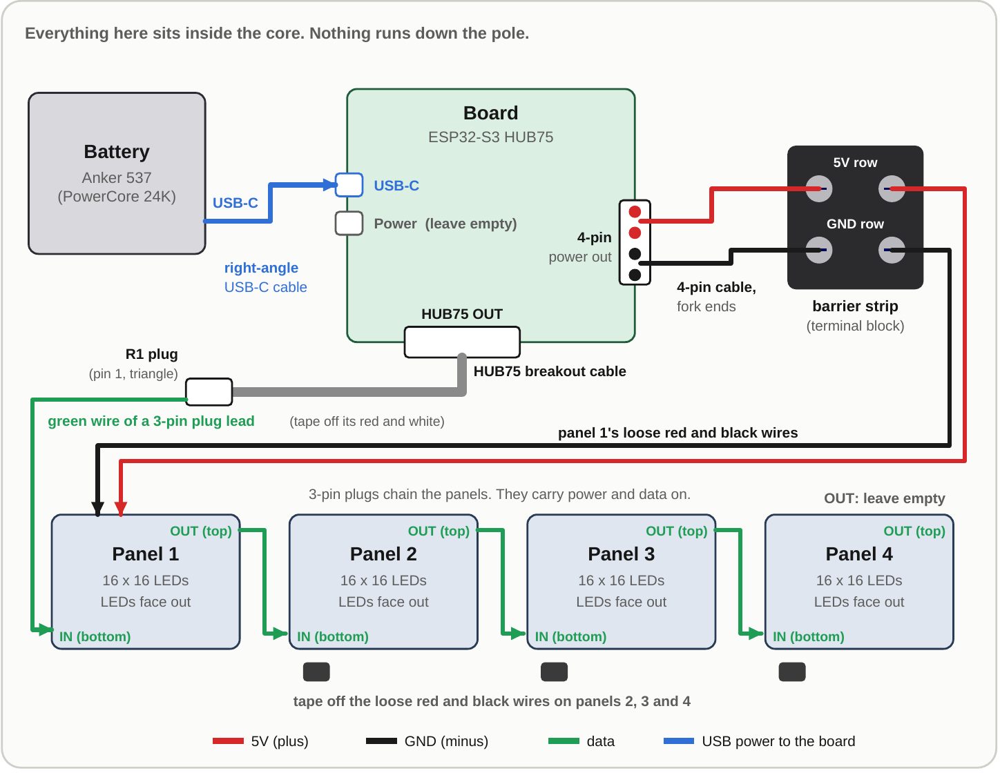

*Panel 1 is the one whose plugs sit at the seam next to the board.*

### Know your plugs

| Part | How to recognise it |
|---|---|
| Panel IN plug | On the panel's 3-pin lead at the **bottom** of the panel. Often labelled DIN. |
| Panel OUT plug | On the 3-pin lead at the **top** of the panel. Often labelled DOUT. |
| Panel's loose wires | A separate red and black pair on each panel. You'll only use panel 1's. Tape the ends of the other three. |
| 3-pin plug colours | Red is 5V, white is GND, green is data. |
| Board's 4-pin power output | A 4-pin socket with 5V and GND pins. Its cable has 2 red and 2 black wires with fork ends. |
| Board's HUB75 OUT | The wide 16-pin socket. The breakout cable plugs in here. Pin 1 (called R1) is the corner marked with a small triangle. |

### Hook it up on the table

Lay the four panels face down in a row on a table, the way they'll go round the ring: panel 1 on the left. Keep the battery out until step 8.

1. **Chain the panels.** Click panel 1's OUT plug into panel 2's IN plug. Then panel 2 OUT to panel 3 IN, and panel 3 OUT to panel 4 IN. Panel 4's OUT stays empty.
2. **Tape off** the ends of the loose red and black wires on panels 2, 3 and 4, one wire at a time, so no bare metal shows.
3. **Board power cable.** Plug the 4-pin cable into the board's 4-pin power output. It only goes in one way.
4. **Barrier strip, 5V row.** Put both red forks under one screw of the top row and tighten. Under the other screw of the same row, put panel 1's loose red wire.
5. **Barrier strip, GND row.** Put both black forks under one screw of the bottom row, and panel 1's loose black wire under the other screw of that row. Tug each wire gently: none should pull out.
6. **Data lead.** Take one half of a JST pair: the half that clicks into panel 1's IN plug. Push the bare end of its **green** wire firmly into the breakout cable's R1 plug (pin 1, by the triangle), and wrap a turn of tape round it so it can't slip out. Tape off its red and white wires.
7. Plug the breakout cable into the board's HUB75 OUT socket, and click the data lead into panel 1's IN plug.
8. **Battery last.** Only once everything else is checked, and only after the firmware is on the board (next section).

> **Check:** Before you ever plug the battery in, look again: both reds in the top row, both blacks in the bottom row, no bare wire touching another, and the USB-C cable in the board's **USB-C** port.

#### Extra checks with a multimeter (optional)

- **Beep mode, battery out:** touch one probe to a screw in the red row and one to the black row. A short chirp is fine; a steady beep means something is shorted. Find it before going on.
- **DC volts, battery in:** red probe on the red row, black probe on the black row. You should read about +5.0. A minus sign means the forks are in the wrong rows.

---

## Flash the firmware

The firmware is free and open source. You'll install the Arduino IDE (a free app for programming boards like this), add the board and two code libraries, then copy the program onto the board over USB. You only do the setup once.

### Set up the Arduino IDE

1. Download and install the **Arduino IDE** from [arduino.cc](https://www.arduino.cc/en/software).
2. Open **Boards Manager** (the board icon on the left). Search for **esp32** and install **esp32 by Espressif Systems**. (Not "Arduino ESP32 Boards": that's a different one.)
3. Open **Library Manager** (the books icon). Install **FastLED** (version 3.9 or newer) and **NimBLE-Arduino** by h2zero (version 2.5.1 is the tested one).
4. Download the code: on this repo's GitHub page, click the green **Code** button, then **Download ZIP**. Unzip it somewhere easy to find.

> Prefer the command line? [`tools/build.sh`](../tools/build.sh) does the same with `arduino-cli`. See [firmware.md](firmware.md).

### Board settings

Plug the board into your computer with a USB-C data cable (battery out). In the Tools menu, set:

| Setting | Choose |
|---|---|
| Board | ESP32S3 Dev Module |
| USB CDC On Boot | Enabled |
| Flash Size | 16MB |
| PSRAM | OPI PSRAM |
| Partition Scheme | one of the 16M options with about 3MB for the app |
| Port | the one that appears when you plug the board in (usbmodem on a Mac, COM on Windows) |

### Your settings file (secrets.h)

1. In the unzipped folder, open `firmware/totem/`. Make a copy of `secrets.h.example` in the same folder and name it `secrets.h`.
2. Find your strap's MAC address: open `firmware/find_whoop_mac/find_whoop_mac.ino`, click Upload (the arrow), then open Tools > Serial Monitor and set it to 115200. Wear your strap (on a Whoop, turn on HR Broadcast in the Whoop app). The monitor lists heart rate devices nearby with their MAC addresses. Note yours.
3. Open `secrets.h` in a text editor and fill in:

| Line in secrets.h | What to put |
|---|---|
| `#define TARGET_WHOOP_MAC "AA:BB:CC:DD:EE:FF"` | Your strap's MAC, in capitals with colons. Works for any heart rate strap, not just a Whoop. |
| `#define CREW_MAC_1 "AA:BB:CC:DD:EE:01"` | Optional: a friend's strap. Remove the `//` at the start of the line to turn it on. |
| `#define CREW_INITIAL_1 'V'` | Optional: your friend's initial. |
| `#define PHONE_PIN "4821"` | Optional: your own PIN for the phone remote. Without it, the PIN is 1234. |

`secrets.h` is never committed to git, so your MAC and PIN stay private if you fork this repo.

### Test one panel first

1. Keep the wiring from the [Wiring](#wiring) section, with the battery **out**. For this test the board powers panel 1 from your computer, at low brightness. The other panels stay dark.
2. Open `firmware/totem_panel_test/totem_panel_test.ino` and click Upload.
3. The panel should show red, then green, then blue (1 second each), then a white dot walking along the rows. Wrong colours or nothing at all? See [Troubleshooting](#troubleshooting).

### Flash the totem

1. Open `firmware/totem/totem.ino`. (Battery still out: the firmware keeps the LEDs dim while a computer is plugged in.)
2. Open the `totem_config.h` tab and set `TOTEM_ORIENTATION_TEST` to `1`. Click Upload.
3. Check the orientation test (below). Then set it back to `0` and upload again. That's the firmware you'll take to the festival.

#### Reading the orientation test

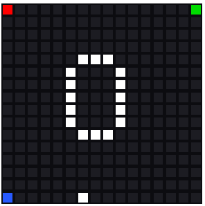

- Each panel shows a number, 0 to 3, the right way up.
- A **red** pixel in its top-left corner, **green** top-right, **blue** bottom-left.
- A white dot walks along the bottom row, through panel 0, 1, 2, 3 in order, without jumping backwards at a seam.
- If any of that is off, change the panel settings in section 2b of `totem_config.h` (below) and upload again.

 

| Setting (section 2b) | Change it when |
|---|---|
| `PANEL_FLIP_Y` | Numbers are upside down. |
| `PANEL_FLIP_X` | Numbers are mirrored (back to front). |
| `PANEL_SERPENTINE` | Rows look scrambled, every other row shifted. |
| `PANEL_TRANSPOSE` | Numbers lie on their side. |
| `RING_REVERSE` | The walking dot jumps backwards at a seam. (Check this once the panels are on the core.) |

The settings in the code are the ones that worked for the original build: `PANEL_SERPENTINE 1`, `PANEL_FLIP_X 0`, `PANEL_FLIP_Y 1`, `PANEL_TRANSPOSE 0`, `RING_REVERSE 1`. With the same panels mounted the same way, you probably won't need to change anything.

### Settings you might want to change

All of these are in `firmware/totem/totem_config.h`, except the zones, which are in `config.h` in the same folder. Change a number, save, and upload again.

| Setting | Default | What it does |
|---|---|---|
| `SHOWS_ENABLED` | 1 | 0 turns the shows off: heart rate only. |
| `SHOW_TEST_MODE` | 0 | 1 plays every show back to back, a few seconds apart, so you can see them all. Set it back to 0 for the festival. |
| `SHOW_EVERY_MIN` | 5 | Minutes between shows. |
| `SHOW_PHRASES` | 7 phrases | The text that scrolls round. Each in quotes, with a comma after each but the last. Up to 60 characters; letters, digits and `' ! . , ? & -` work. |
| `SHOW_SHIP` | 0 | 1 adds the Queen Mary (made for Dreamstate) to the show rotation. |
| `DROP_ENABLED` | 1 | 0 turns the beat drop off and leaves the microphones unpowered. `DROP_TEST_MODE 1` shows a sound meter instead, so you can check it hears the music. |
| `LED_MAX_MA` | 1800 | Power limit for the LEDs, in milliamps. 1800 gives about 6.5 to 7 hours on the Anker 537. Higher is brighter but runs out sooner. |
| `CREW_FACES` | 1 | 0 shows only you on all four sides, even if a friend is connected. |
| `PHONE_ENABLED` | 1 | 0 turns the phone remote off. |
| `TOTEM_ORIENTATION_TEST` | 0 | 1 shows the setup screen instead of the heart rate. |
| `REST_BPM`, `ZONE1_BPM`, `ZONE2_BPM`, `ZONE3_BPM` | 60, 100, 110, 120 | In `config.h`, section 4. Where the bar starts and where each colour zone begins. Set them for your own heart. |

### Phone remote

1. Make sure you set a PIN in `secrets.h` before flashing.
2. On your iPhone, install the free **Bluefy** browser from the App Store. (Safari can't talk to Bluetooth devices.)
3. In Bluefy, open the remote page: **`noahsw.github.io/heart-rate-totem/remote/`** and bookmark it. Add `?demo` to the end of the address to try the page without a totem.
4. With the totem on, tap **Connect**, pick **Totem** and type your PIN. The page remembers it.

> **Tip:** The totem can connect to 3 Bluetooth devices at once: your strap, one friend's strap and the phone. For more friends, section 6 of `totem_config.h` explains the one setting to change.

If you fork this repo, you can host your own copy of the page: see [firmware.md](firmware.md#phone-remote).

---

## Put it together

All the screws go **up from underneath** into hex nuts pressed into pockets. Press every nut in before you start, so you're never chasing one inside the totem.

### 1. Press in the nuts

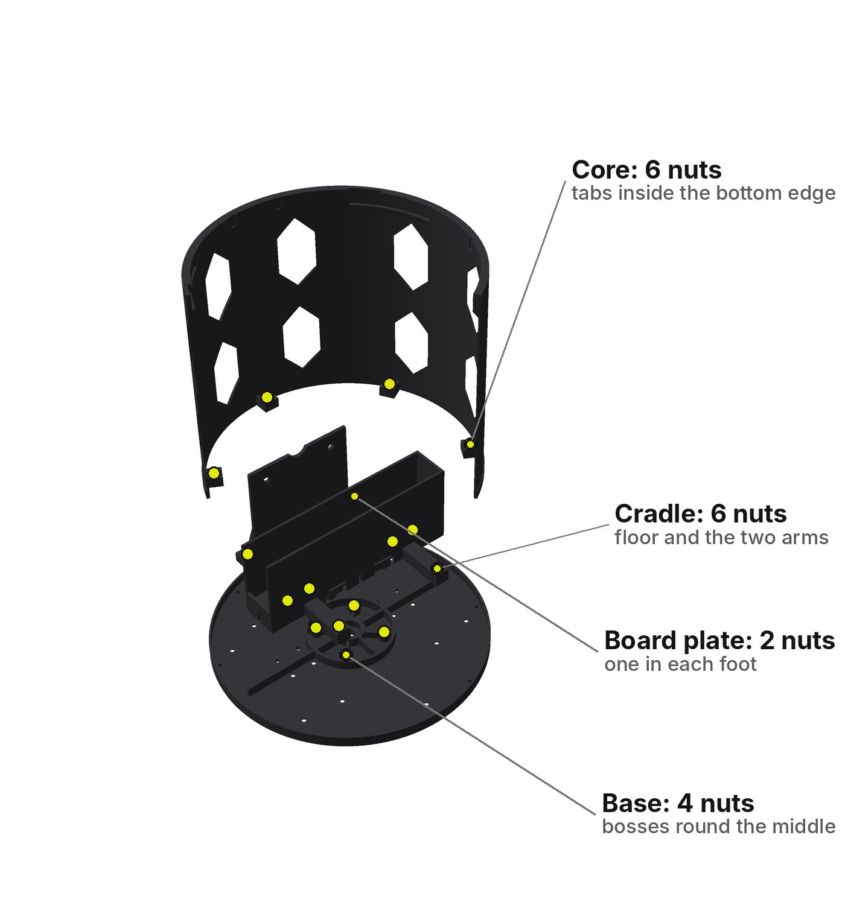

22 nuts in all:

- **Base:** 4, in the round bosses near the middle.
- **Battery cradle:** 6, in its floor and its two arms.
- **Board plate:** 2, one in each foot.
- **Core:** 6, in the tabs inside its bottom edge.
- **Board:** 4 more, used in step 2.

> **Tip:** If a nut won't stay put, a dab of glue or a bit of tape over the pocket holds it.

### 2. Mount the board on its plate

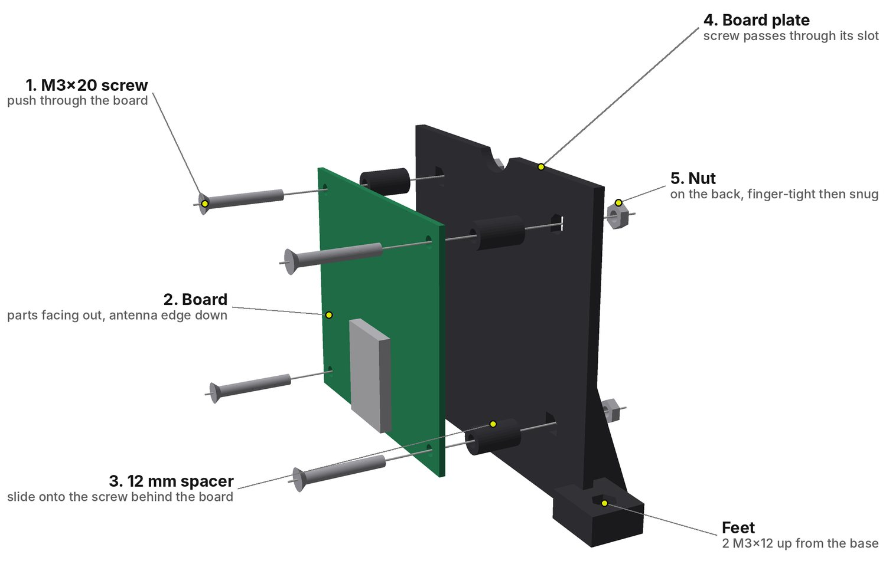

1. Push an M3x20 screw through each corner hole of the board, from the side with the parts on it.
2. Slide a 12 mm printed spacer onto each screw behind the board. (The plate's file has 5 spacers: one is a spare.)
3. Pass the screws through the plate's slots and put a nut on each at the back. Finger-tight, then snug.
4. The board's **antenna edge goes down**, toward the base, so Bluetooth reaches out through the ring. The side with the parts faces away from the plate, toward the middle of the totem.

### 3. Bolt the pole adapter to the base

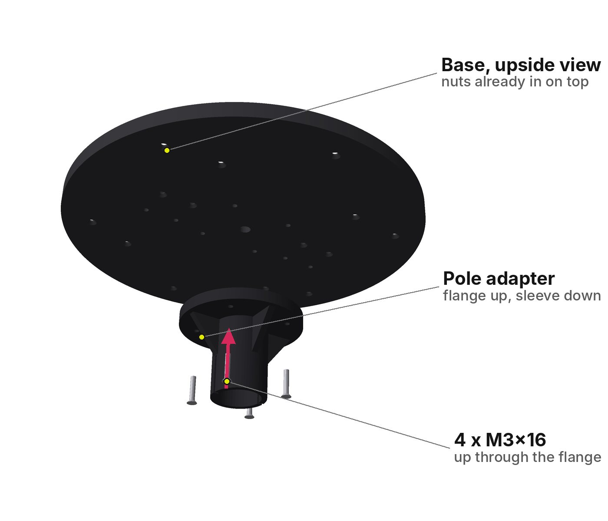

1. Turn the base upside down.
2. Set the pole adapter on it, flange against the base, sleeve pointing up at you, with its 4 holes over the 4 holes in the base.
3. Drive the 4 M3x16 screws through the flange into the nuts. Tighten them firmly: this joint takes all the sway.

### 4. Fit the battery cradle and board plate

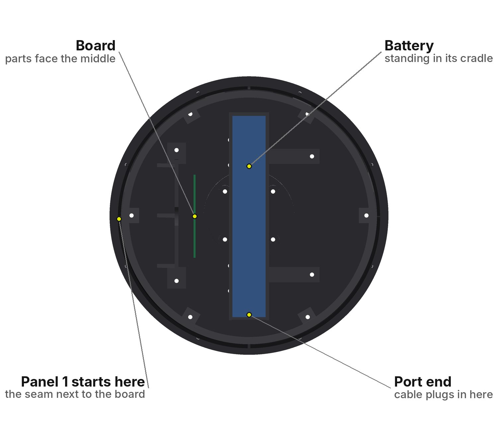

1. Turn the base the right way up. Thread the strap (at least 16 inches of hook-and-loop) through both channels under the cradle's floor before you fit it.
2. Stand the cradle in the middle of the base so its 6 nuts sit over 6 holes. Fit 6 M3x12 from below. The low end of the cradle is the port end.
3. Stand the board plate on its two feet over the two holes near the edge. Fit 2 M3x12 from below. The board's parts face the middle.

*Seen from above. The battery is shown in blue; it goes in last, in step 9.*

### 5. Fit the core

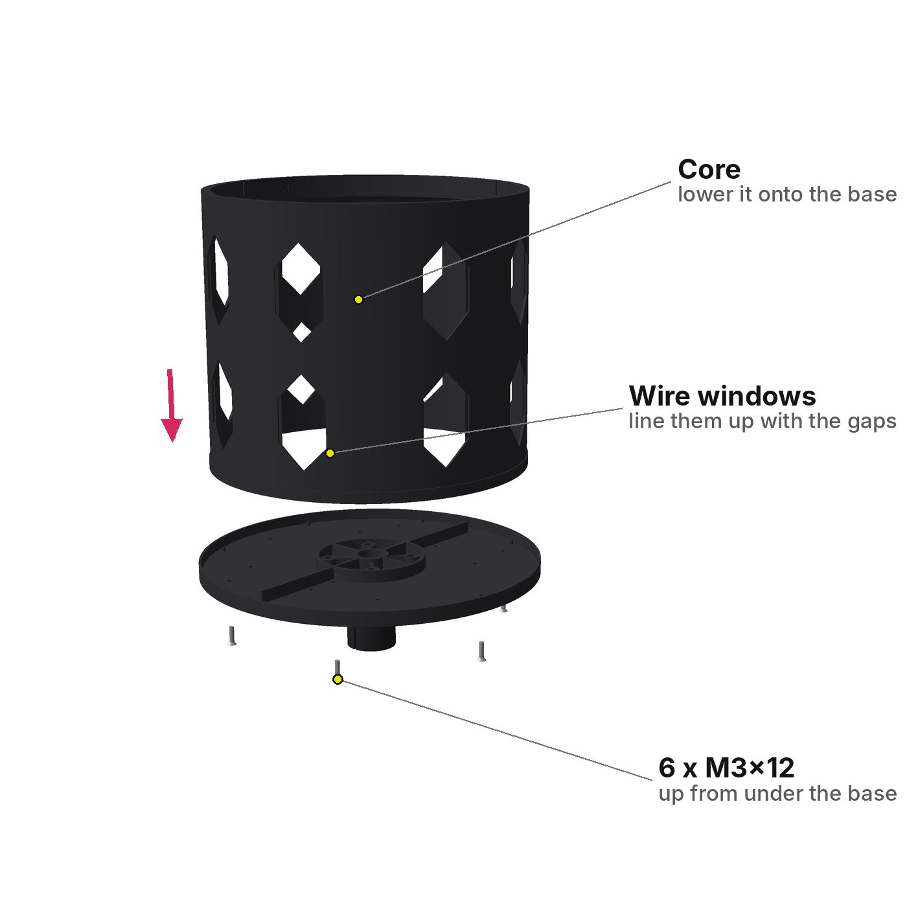

1. Lower the core over the cradle and board onto the base.
2. Turn it until a pair of wire windows sits right behind the board plate, and another pair on the opposite side. That lines the windows up with the gaps between panels.
3. Fit 6 M3x12 up from under the base into the core's tabs.

> **Careful:** Don't overtighten screws into printed parts. Snug is enough; past that, the plastic strips.

### 6. Wrap the panels round the core

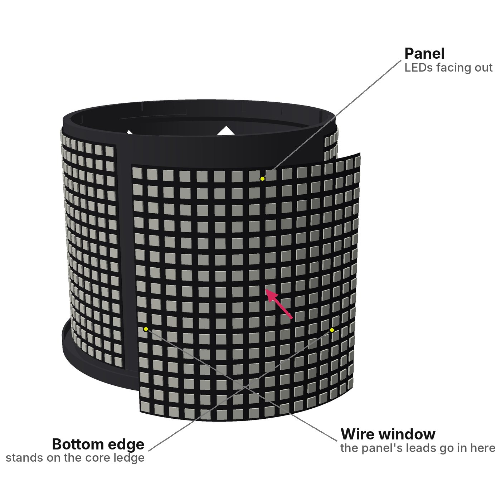

1. Start with **panel 1**: its IN plug and loose wires go at the seam next to the board.
2. Wrap it round the core, LEDs facing out, bottom edge standing on the core's ledge.
3. Feed its leads in through the windows: IN and the loose wires through the low window, OUT through the high one.
4. Do the same with panels 2, 3 and 4 going round, edges touching. Inside the core, connect each OUT to the next panel's IN, and make the connections from the [Wiring](#wiring) section. The barrier strip sits loose inside.
5. Hold the panels with a strip of tape for now. The grid will hold them for good.

### 7. Slide on the grid quarters

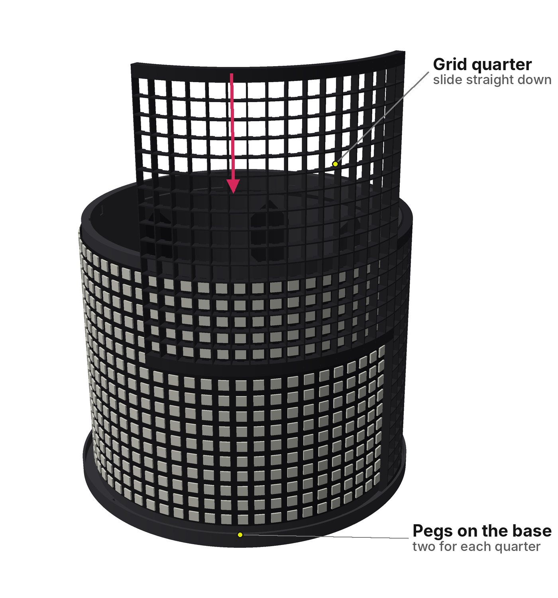

1. Slide a grid quarter straight down over each panel, so each LED sits in a square cell.
2. Its two holes underneath drop onto two pegs on the base. Wiggle it gently until it drops.
3. The quarters press the panels in against the core, so take off any tape as you go.
4. Where two quarters meet, their thin half-fins sit side by side over the seam.

> **Tip:** A quarter that feels loose can get a dot of glue on its pegs. It shouldn't need it.

### 8. Slide on the skin

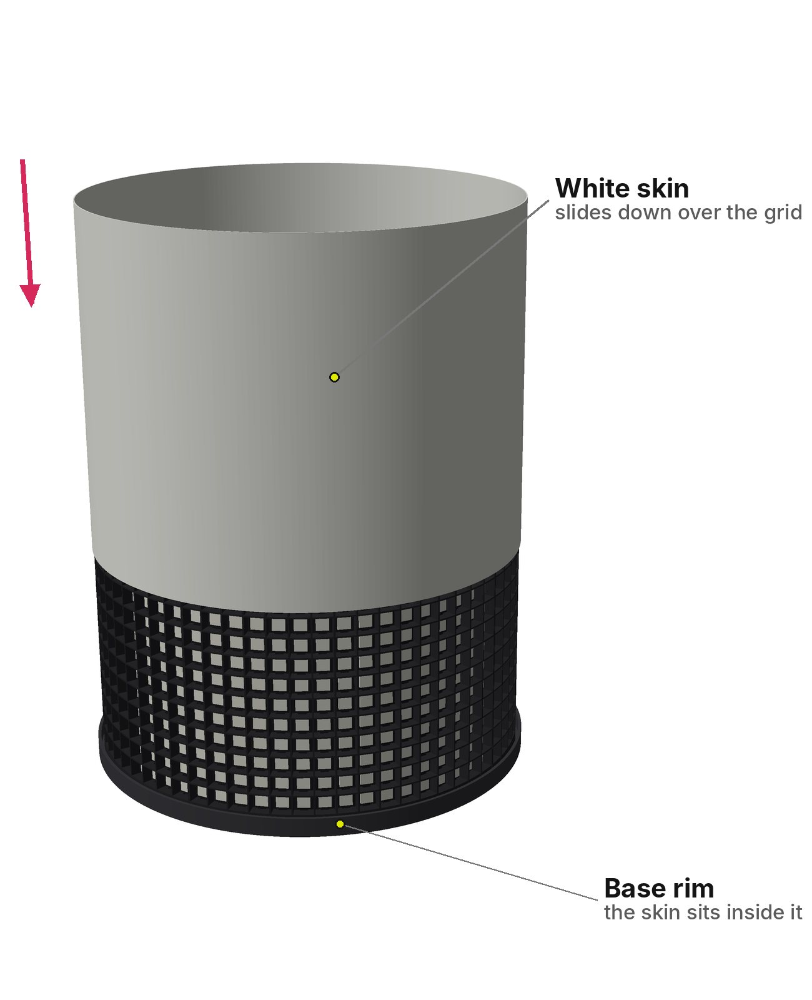

1. Slide the white skin straight down over the grid until it sits inside the rim of the base.
2. Go slowly and keep it level: it's thin and can crease if forced.
3. If you printed the thicker backup skin, turn it so its seam line sits over a fin.

### 9. Battery, strap and cap

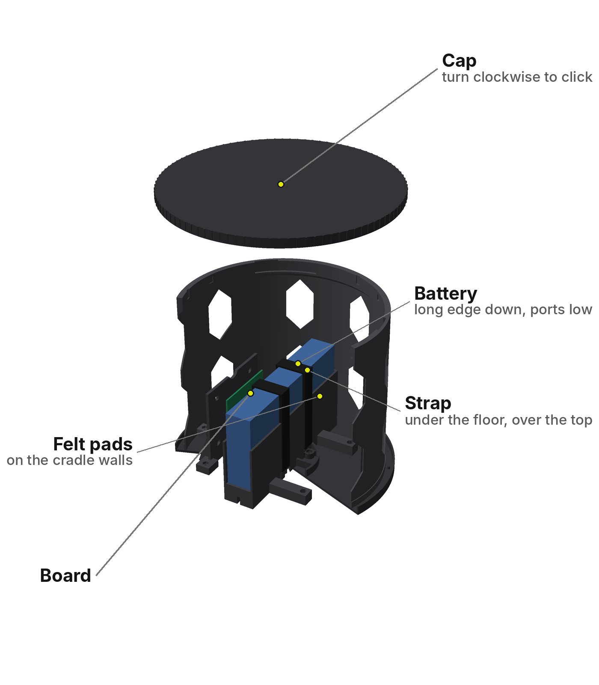

1. Stick felt pads on the inside walls of the cradle, where the battery will touch.
2. Stand the Anker 537 in the cradle on its long edge, with its ports at the low end.
3. Wrap the strap up and over the battery and press it closed, tight enough that the battery can't lift.
4. Plug the right-angle USB-C cable into the battery and into the board's **USB-C** port (not Power). The totem should light up.
5. Put the cap on the top and turn it clockwise, looking from above, until it clicks.

> **Tip:** To turn the totem off, take the cap off and unplug the cable from the battery. The phone remote's lights-off button only blanks the LEDs.

### 10. Put it on the pole

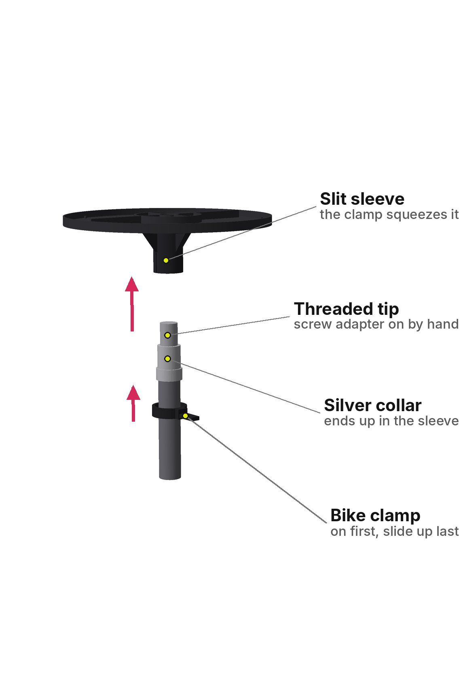

1. Slide the bike clamp onto the pole first, below the silver collar, lever open.
2. Screw the totem's adapter onto the pole's threaded tip, by hand, until the top of the silver collar is seated firmly inside the sleeve.
3. Slide the clamp up onto the slit part of the sleeve and close the lever. It squeezes the sleeve so the totem can't unscrew while you dance.
4. To take it off: open the clamp and unscrew the whole totem.

> **Tip:** If your pole is different, only the adapter needs to change. Its size is a setting in [`hardware/v1/build_modular.py`](../hardware/v1/build_modular.py) (`POLE_D`).

---

## Test it

### First power-on

1. Battery in, cable in: within a few seconds all four sides should light up.
2. Before your strap connects you'll see a slowly beating heart with no number. That's normal.
3. Put your strap on (Whoop: HR Broadcast on). Usually within a minute, your BPM appears and the heart beats with you.
4. Roll the thumb wheel: the brightness should change, and a row of dots shows the level for 2 seconds.
5. Turn `SHOW_TEST_MODE` on once to watch every show back to back, then turn it off again.
6. With the totem on the core, run the orientation test once more and check the walking dot doesn't jump backwards at a seam (`RING_REVERSE`).

### 1-hour test

Leave it running for an hour at the brightness you'll use, with your strap on. Check that:

- Nothing gets more than warm. The board and battery may feel slightly warm; nothing should be hot.
- The panels never flicker or flash random colours.
- The board doesn't restart (a restart shows as a short blank, then the searching heart again).

### Shake test

With the totem on the pole, hold the pole and give the ring a few firm shakes, the way it'll move in a crowd. Nothing should rattle, the clamp shouldn't slip, and the flange under the base shouldn't flex. If anything moves, tighten it before the festival, not during.

---

## Troubleshooting

| What you see | What to try |
|---|---|
| Board does nothing at all | Is the cable in the port marked **USB-C**, not Power? Try another cable. If the board stays dark on a USB-C to USB-C cable, use the battery's USB-A port with a right-angle USB-A to USB-C cable. |
| Board is on, panels dark | Check the data lead: green wire firmly in the R1 plug (the triangle end) and clicked into panel 1's IN, not OUT. Check the barrier strip screws are tight. |
| Only some panels light | The chain stops at the first dark panel: reseat the OUT plug before it and that panel's IN plug. |
| Wrong colours or random flicker | Reseat the data lead and keep it short. If it keeps happening, the data signal may be too weak for the panels; a small part called a level shifter (74AHCT125) fixes that. |
| Upload fails in Arduino | Check the board settings and the port. If the board has a BOOT button, hold it while you click Upload, and let go when it starts writing. |
| Totem never shows my BPM | Check the strap's MAC in `secrets.h` (capitals, colons). On a Whoop, turn on HR Broadcast. Only one app can connect to a strap at a time: close fitness apps on your phone. |
| Board restarts at high brightness | Lower the brightness with the wheel, or lower `LED_MAX_MA`. |
| Upside-down or mirrored faces | Run the orientation test and change the section 2b settings. |
| Phone can't find the totem | Use Bluefy, not Safari. Check `PHONE_ENABLED` is 1. Three devices at most: your strap, one friend, the phone. |
| Cap won't click | Line up its three lugs with the slots in the core's top, push down, then turn clockwise from above. |
| Beat drop fires at the wrong time, or never | Set `DROP_TEST_MODE 1` to see what the mics hear. `DROP_ENABLED 0` turns it off. |

---

## Festival-day checklist

### The night before

- [ ] Battery charged to full.
- [ ] Firmware flashed with `SHOW_TEST_MODE 0` and `TOTEM_ORIENTATION_TEST 0`.
- [ ] Your strap charged. Whoop: HR Broadcast on.
- [ ] A friend's strap charged, if you set one up.
- [ ] Phone remote bookmarked in Bluefy, PIN remembered.
- [ ] Check the festival's rules on poles and totems (height, material, thickness).

### Before you leave

- [ ] Clamp tight, adapter screwed all the way on.
- [ ] Cap clicked shut.
- [ ] Shake test: nothing rattles.
- [ ] Spare: a few M3 screws and nuts, a strip of electrical tape, the screwdriver or hex key.
- [ ] Charging cable for the battery, if you'll have a chance to top it up.

### At the festival

- Switch on when you arrive: cap off, plug in the battery, cap on. The first show plays 5 minutes after power-on.
- The battery lasts about 6.5 to 7 hours at the middle brightness. Go a level down if you need longer.
- Rest the pole on the ground and hold it. Don't swing it over people's heads.
- Off at the end: cap off, unplug the battery.

---

## Good to know

- The pictures in this guide are drawn from the 3D design, not photos. Real parts look the same but may differ in small details.
- Print times and plastic weights are estimates. Bambu Studio gives the real numbers.
- The board needs a short USB-C cable from the battery. If it stays dark on USB-C to USB-C, use the battery's USB-A port with an A to C cable.
- The printed parts are sized for the panels, battery, board and clamp in the parts list. Other parts may need the design adjusted: every size is a setting at the top of [`hardware/v1/build_modular.py`](../hardware/v1/build_modular.py), and [`hardware/README.md`](../hardware/README.md) explains how to rebuild the print files.
